<a href="https://mato8q.github.io/">
  
</a>

<h1 align="center">hi~ I'm Keira 🐈💤</h1>
<p align="center">
  <b>Supharada Jundok</b> | ศุภรดา จันทร์ดก | 李沛妤<br>
  M.S. CSIE @ NCKU, Taiwan · ML, CV, UAV remote sensing & cybersecurity
</p>

<p align="center">
  <a href="https://mato8q.github.io/"></a>
  <a href="https://www.linkedin.com/in/supharada-jundok-090a48239"></a>
  <a href="https://medium.com/@mato8q"></a>
  <a href="https://www.kaggle.com/supharadajundok"></a>
</p>

### 👋 about me

- 🎓 M.S. in CSIE @ NCKU, Taiwan (current)
- 🎓 B.S. in CSIE @ NDHU, Taiwan
- 🗣️ Languages: Thai & Laotian (native) · English · Mandarin · Spanish
- 📚 Learning: Bahasa Indonesia · Japanese
- 🥊 Hobbies: writing, Muay Thai, kickboxing, boxing & weight training

```text
> whoami
  Meaw meaw lover who can code

> cat interests.txt
  ML · CV · UAV remote sensing · cybersecurity

> ls ~/medium
  csie_ndhu_course_reviews/  digital_logic_from_zero.md  tech_podcasts.md  education_essays/
```

✍️ I write in Thai on **[Medium](https://medium.com/@mato8q)**: CSIE course reviews, a self-study guide to digital logic, tech podcast picks and essays on education.

### 📈 this year on github

<p align="center">
  
</p>

<p align="center">
  <a href="https://mato8q.github.io/">→ more about me, my research and writing at <b>mato8q.github.io</b></a>
</p>
